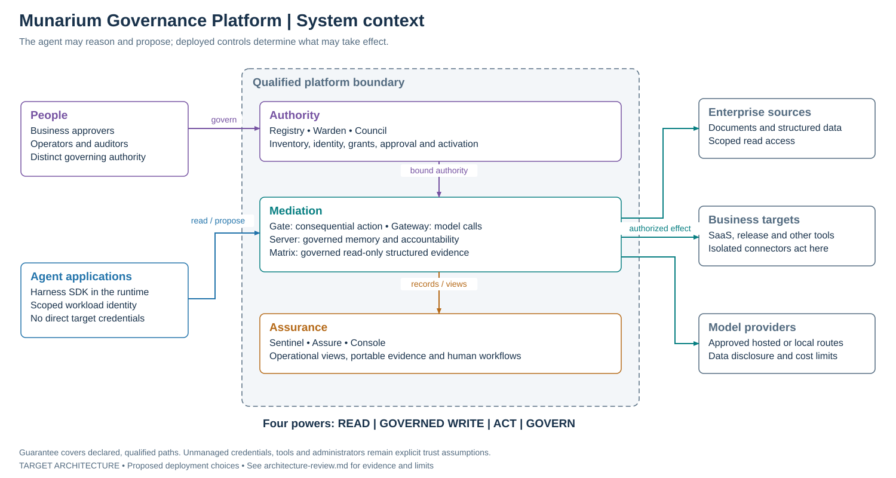
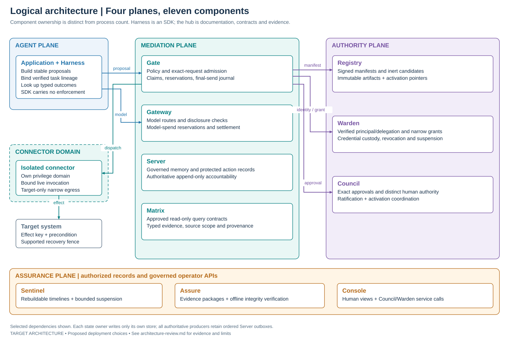
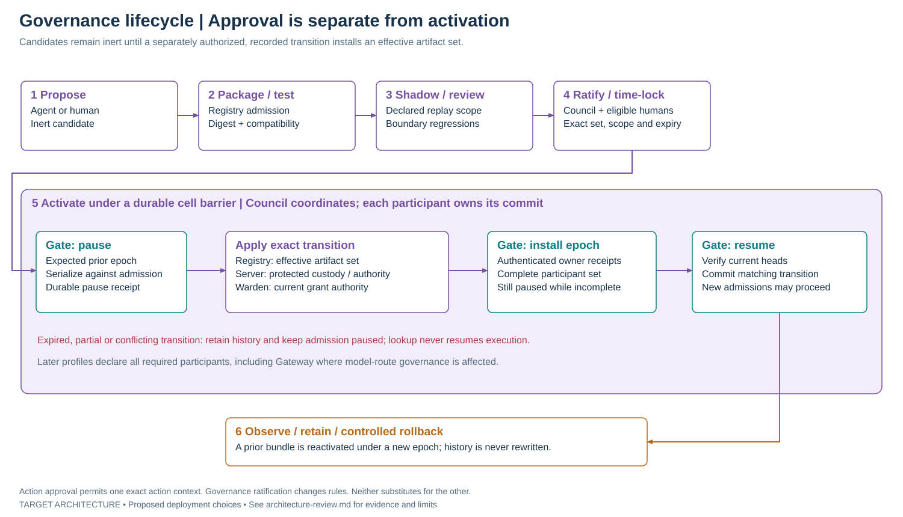
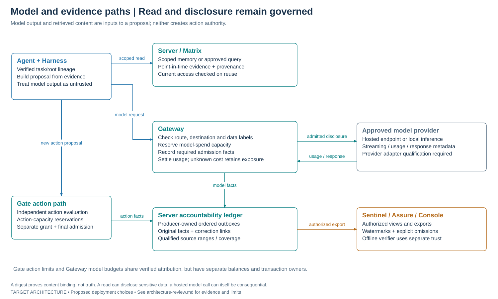
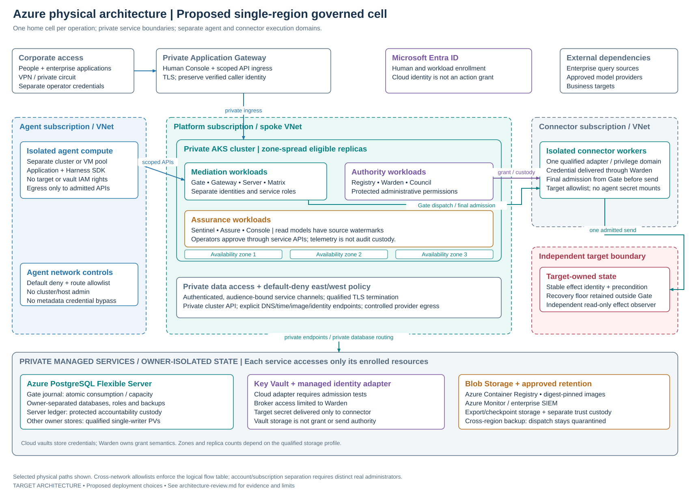
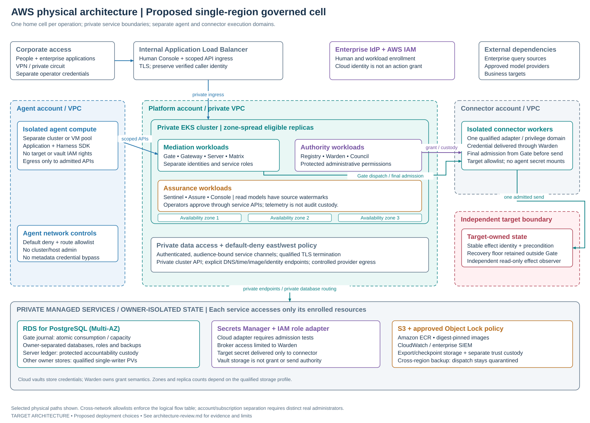
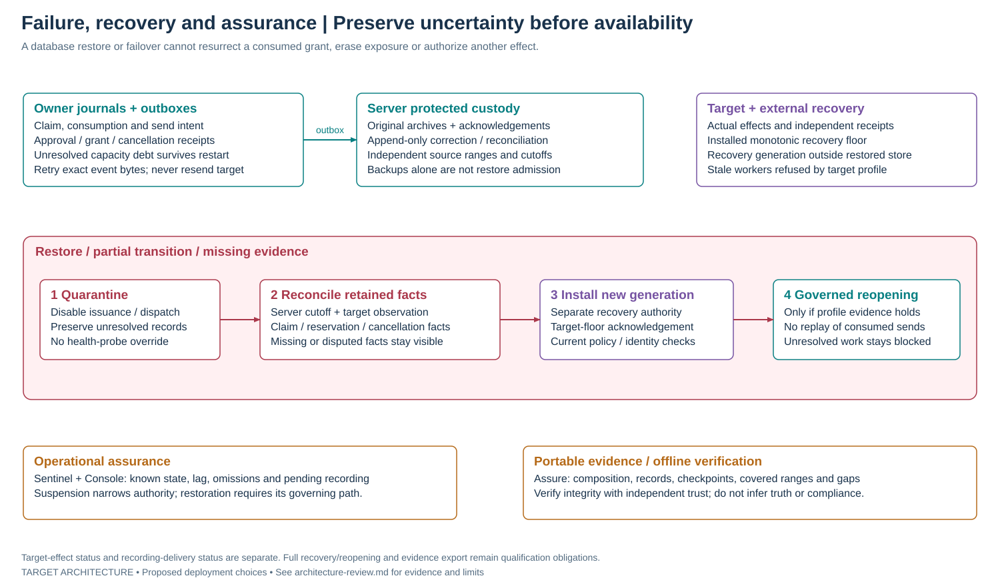

# Munarium Governance Platform: architecture review

**Review date:** 11 October 2026. **Scope:** the completed platform's intended behavior, architecture and cloud deployment. **Status:** target architecture, with proposed physical profiles; this document is explanatory review material, not a new contract, acceptance record, release composition or deployment instruction.

The source baseline is the public hub at `b5fb7375977dce14b26dcd9909c610a9c5a45f93`. The [platform plan](../platform-plan.md), [decision register](../decisions/README.md), [foundation requirements](foundation-requirements.md) and [Stage 2 implementation record](../stage2-implementation.md) provide the requirements and reported implementation evidence. Component repositories remain authoritative for their code. This review does not independently rerun their qualification or advance their catalog status.

## Executive summary

Munarium Governance Platform is intended to make an AI application's use of enterprise data, models and tools accountable to explicit organizational authority. An agent can retrieve authorized information, contribute governed memory and propose work. Separate services decide whether that work may execute, who must approve it, which narrow credentials an isolated connector may receive, and which records must exist before an external effect is attempted.

The central architectural choice is to keep **read, governed write, act and govern** as distinct powers. An agent's ordinary identity cannot activate its governing rules or obtain a general target credential. A policy decision is bound to the actual request, verified identity, evidence, manifest and active policy versions. Consequential execution then crosses additional boundaries: exact approval where required, a durable claim, a narrow Warden grant, atomic Gate admission, acknowledged accountability records and a final live admission to send. Server preserves the history; Sentinel, Assure and Console explain and export it without becoming alternate sources of execution authority. These responsibilities follow the [four-plane architecture](../platform-plan.md#5-four-planes-one-bounded-guarantee).

The resulting business capability is controlled delegation: organizations can let agents prepare and perform explicitly bounded work while retaining human governance over sensitive actions and changes to the rules. It is also an investigation capability. When a target may have acted but its response is lost, the platform retains an unresolved outcome and its capacity exposure. It does not hide uncertainty behind a success response or blindly repeat an irreversible action.

The architecture is coherent, but its value depends on deployment enforcement. Every claimed action path must exclude direct agent credentials and alternate target routes. Authority state, execution journals and accountability records need distinct ownership. Administration, signing, bootstrap and recovery must remain outside the ordinary agent privilege domain. Separate service names or cloud resources do not establish independent human oversight.

**Review recommendation:** continue toward a qualified single-cell composition before adding connector breadth or multi-region execution. Azure and AWS can host the proposed layout using private compute, owner-isolated persistence, workload identity, controlled egress and separately retained recovery evidence. The cloud diagrams below are design proposals. The existing [Stage 1 acceptance packet](stage1-acceptance.md) and [Stage 2 execution evidence](../stage2-implementation.md) describe bounded experimental work; the latter explicitly retains `qualification:false` and open isolation, dynamic evaluation and restore/reopening work. They do not establish a fully implemented production platform.

## Reading the diagrams

The review proceeds from [system boundary](#1-system-purpose-and-boundary) and [component ownership](#2-logical-architecture-and-component-ownership) to [action execution](#3-a-consequential-action-from-intent-to-outcome), [governance changes](#4-governance-changes-and-bootstrap), [model/evidence paths](#5-model-calls-governed-memory-and-structured-evidence) and [persistence](#6-data-architecture-and-persistence). The [Azure](#7-proposed-physical-architecture-azure) and [AWS](#8-proposed-physical-architecture-aws) profiles are followed by [recovery/assurance](#9-availability-uncertainty-recovery-and-assurance) and [findings/completion gates](#10-review-findings-and-completion-gates).

Blue denotes agent/application activity; teal denotes mediation; purple denotes authority; amber denotes assurance; red denotes uncertainty or recovery restrictions. Arrows show selected dependencies or ordered interactions, rather than every network connection. Dashed boundaries identify proposed deployment or qualification scopes. The flow table and storage tables supply the obligations that a simplified drawing cannot express.

All eight figures are original, editable SVG assets under [images](images/). They contain accessible titles and descriptions, require no external resources, and can be regenerated with the standard-library [renderer](images/render_architecture.py):

```console
python docs/architecture/images/render_architecture.py
```

## 1. System purpose and boundary



*Figure 1. The intended governance boundary surrounds mediated paths and their authority and accountability services. The hub repository supplies design and versioned artifacts; it is not a live authority service or a production GitHub dependency.*

| Power | Intended path | What the platform must preserve |
|---|---|---|
| Read | Application to Server or Matrix | Tenant, compartment, user and query scope; approved source access; provenance and point-in-time meaning. Read-only does not mean free of disclosure or cost consequences. |
| Governed write | Application to Server | Claims, findings, corrections and supersession are append-only, attributable and subject to governed memory rules. Writing a claim cannot install active governance. |
| Act | Harness to Gate, then an isolated connector to its target | Verified identity, manifest, policy, evidence, obligations, exact grant/custody, cumulative limits, durable admission and actual outcome evidence. |
| Govern | Inert proposal intake; separately authorized Council coordination and owner activation APIs | Distinct ratification and activation authority, exact artifact digests, expected prior state, participant receipts and recorded effective epochs. |

Gateway mediates model calls as a separate disclosure and spending path. A model can suggest a tool call, but its suggestion must enter the Gate action path before any governed external effect. Discovery may inventory a capability; it cannot activate it. These rules come from the [platform principles and principal flows](../platform-plan.md#4-four-powers-and-the-controls-around-them).

The intended guarantee applies to **named systems, paths, credentials and administrative roles in a qualified deployment**. It does not guarantee model correctness, discover every unmanaged tool, control an unrelated credential, or prove that every recorded assertion is true. Host, cluster, database, identity and release administrators are part of the trust model. Their actual privileges must be disclosed in the deployment's boundary record; see [system boundaries](system-boundaries.md) and the [governance authority boundary](../../GOVERNANCE.md#the-authority-boundary-in-a-one-person-organization).

## 2. Logical architecture and component ownership



*Figure 2. Nine planned platform components build on Server and Matrix. The isolated connector is an execution boundary owned by the Gate/Warden protocol, not a twelfth named platform product.*

| Component | Completed-platform responsibility | Boundary that must remain intact |
|---|---|---|
| Harness | Proposal construction, stable operation identity, framework adapters, typed results and diagnostics inside applications | SDK cooperation is convenient; enforcement resides outside the agent. No target secret or activation credential. |
| Gate | Pinned policy evaluation, obligations, action journal, claims, reservations, grant consumption and final dispatch admission | Sole owner of its local action transaction; neither governance ratifier nor a generic exactly-once target guarantee. |
| Gateway | Approved model routing, data-release checks, task-attributed spending admission and usage settlement | Preserve Server's accounting lineage; reserve before dispatch; missing usage or price does not become zero exposure. |
| Server | Governed memory, protected action records, governance-authority boundary and authoritative accountability history | Ordinary memory writers cannot activate governance; durable acknowledgements preserve immutable content and producer provenance. |
| Matrix | Approved read-only structured query contracts and typed, scoped evidence | Preserve source authorization and lineage; no target-write path or automatic low-consequence classification. |
| Registry | Inventory, ownership, signed manifests, immutable policy artifacts and effective activation pointers | Discovered/submitted candidates stay inert; effective pointer changes require admitted authority and compatibility. |
| Warden | Provider identity admission, delegation checks, narrowly bound grants, connector credential custody, revocation and suspension | Integrate an identity provider and credential store; do not expose target credentials to agents or redefine cloud IAM as an action grant. |
| Council | Exact-request approval, eligibility, governance ratification and activation coordination | Obtain canonical owner records; action approval cannot execute a target or replace governance activation. |
| Sentinel | Source-linked timelines, coverage/lag visibility and pre-authorized narrowing requests | Views are rebuildable. Suspension uses Warden; Sentinel cannot restore broader authority or replace local admission checks. |
| Assure | Portable evidence packages and independent offline integrity/reference/coverage verification | Explicit omissions and separate verifier trust; no automated certification or claim that signatures prove event truth. |
| Console | Human inventory, decisions, approvals, unresolved work and evidence views | Human actions call the governed APIs under current authority; no direct database or hidden administrator path. |

The roles above are supported by the [documentation overview](../README.md#the-nine-new-components) and [ownership model](system-boundaries.md#ownership). Component count does not prescribe eleven daemons or hosts: Harness is an SDK; Assure may include an offline verifier; service co-location is permitted only where the profile retains the required privilege and state boundaries.

### Identity and authority binding

Provider credentials establish an enrolled subject; they do not grant an arbitrary action. Warden verifies the provider, tenant, recipient, validity and admitted delegation chain. Claims such as "human approver" or "owner" supplied by an agent cannot establish those roles. A production provider adapter needs its own enrollment, revocation and confused-deputy tests; the experimental human mTLS profile is narrower than general enterprise SSO.

Durable business intent is separate from refreshed authentication and from an authorization attempt. Operation, attempt, claim, grant and effect identities bind their qualified domain, tenant and home cell. Authority revisions, activation epochs, recovery generations, producer sequences, worker fences and target versions have different owners and meanings. A higher value in one cannot substitute for another. See [identity admission](../decisions/0005-warden-identity-admission.md), [bootstrap authority](../decisions/0003-bootstrap-principal-context.md) and [contract evolution](../decisions/0011-platform-contract-evolution.md).

## 3. A consequential action from intent to outcome


*Figure 3. The final live admission is a send opportunity. Looking up its durable record after a lost response is evidence, not replacement permission to send.*

Consider an agent preparing publication of a fictional release artifact to a disposable target. The business application persists the release intent and stable operation identity before calling Harness. Gate authenticates the caller and resolves the admitted capability, activated policy, artifact digests and evidence. It computes canonical request/context digests itself, checks target preconditions, determines consequence and evaluates all mandatory typed obligations. Unknown required obligations, policy errors or missing evidence refuse admission.

The target design retains the plan's consequence vocabulary: C0 bounded observation, C1 bounded ordinarily reversible internal change, C2 bounded external or more consequential internal effect, C3 irreversible/sensitive/production-critical effect requiring distinct authority, and C4 no authorized execution path for that principal or deployment. Classification depends on verified context, destination and downstream effects. A caller cannot lower it by labelling the work "safe". The [consequence-class section](../platform-plan.md#181-a-shared-vocabulary-with-explicit-scope) defines the contextual defaults, rather than an unconditional approval rule for every C0–C2 call.

Where approval is required, Council retrieves the actual canonical request and decision from their authenticated owner. An eligible approver sees the target, effects, evidence, policy and expiry and approves that exact context. A changed request, expired approval or changed relevant authority cannot reuse it. Gate records an immutable claim; Warden issues a narrow claim-bound grant only after independently checking current authority and the claim. An identical issuance retry returns the original grant and expiry.

Gate then performs **one local transaction** to consume the grant, acquire worker ownership/fence, reserve every admitted action-capacity bucket and retain the predispatch recording intent. It delivers that exact event to Server and verifies the durable acknowledgement. Warden validates current custody and delivers credentials only to the bound isolated connector. The connector asks Gate for final admission. Under the admission/activation/cancellation lock, Gate rechecks current bindings and exact custody, commits irreversible send intent and spends the single send opportunity. Only the first successful live admission response allows that invocation to send.

The target adapter must atomically bind its effect to the declared effect identity, content, precondition and supported recovery fence. A definitive receipt can establish completion; a timeout or lost receipt may leave the effect unresolved. Gate retains the result and its Server outbox, and authorized investigation appends reconciliation facts. Compensation is a separately authorized, linked action. There is no distributed transaction across Gate, Warden, Server and the target, and no generic exactly-once external-effect promise. The [execution protocol](../decisions/0002-action-execution-protocol.md), [action lifecycle](action-lifecycle.md) and [experimental integration record](../decisions/0014-stage2-service-integration.md) define these boundaries.

| Situation | Required interpretation and behavior |
|---|---|
| Request accepted or approval pending | Work has a durable reference; no target effect authority is implied. |
| Same operation/intent retried | Return the original reference/state; changed content conflicts. Do not silently invent a new identity. |
| Final-admission response lost | Do not send on lookup/retry. Retain the spent opportunity and uncertainty until the applicable reconciliation can establish facts. |
| Target acts but response is lost | Preserve unresolved exposure; independent read-only target evidence may settle it. No automatic resend. |
| Cancellation or approval withdrawal | Race durably with final admission. Before admission it can stop work; afterward report too late and preserve the actual effect state. |
| Outcome known, Server delivery pending | Show the effect result and recording status separately. A known effect is not a complete accountability chain. |

### Enforcement modes

Observe/shadow modes support adoption and policy evaluation; they cannot be presented as enforced execution. The actual mode and active epoch are part of decision context. Moving from enforce to observe is itself a governed change. A shadow allow cannot satisfy an execution obligation or replace an original refusal; see [policy promotion](../platform-plan.md#192-promotion-and-rollback) and [historical interpretation](../decisions/0011-platform-contract-evolution.md#evidence-meaning-and-historical-interpretation).

## 4. Governance changes and bootstrap



*Figure 4. Ratification, participant application and completed activation are different states. Installing a Registry pointer alone does not complete the governed cell transition.*

Governance changes include policy bundles, manifests, approver eligibility, trust admission, revocation behavior and enforcement-mode changes. Agents may propose candidates through an inert intake. Registry validates the signed artifact's owner, tenant, compatibility and exact bytes; packaging and testing do not grant activation. Shadow replay reports its sample, exclusions, reconstructed inputs and changed decisions. Separately authorized ratification binds the candidate set, scope, expected prior state, participants and validity window.

Council coordinates the transition while each participant commits only its own state. Gate pauses admission durably and serializes the barrier against action consumption and final send. Registry, Server and Warden apply the exact admitted transition and expose authenticated receipts/current heads. Gate installs its epoch while paused and resumes only after checking the required complete receipt set and current owner state. Missing, partial, expired or conflicting transitions keep the barrier closed. A later profile must include Gateway when model-route authority is affected.

Rollback activates a known artifact through a **new** governed epoch; it never rewrites old decisions. Bootstrap uses separately enrolled non-agent authority, explicitly scoped initial bindings and recorded retirement into normal governance. Recovery and emergency powers need pre-authorized scope and retained evidence; neither is an agent-accessible way around approval. These requirements follow [authority and durability](../decisions/0010-stage2-authority-durability.md), [activation integration](../decisions/0014-stage2-service-integration.md), [bootstrap context](../decisions/0003-bootstrap-principal-context.md) and the [governance lifecycle](../platform-plan.md#19-governance-changes-and-the-policy-toolchain).

## 5. Model calls, governed memory and structured evidence



*Figure 5. Action limits and model budgets share verified task attribution, but retain separate balances and transaction owners.*

Server provides claims, history, corrections and evidence under tenant, compartment and user authorization. Matrix executes reviewed query contracts under source access controls and produces typed evidence with query parameters, source/schema provenance and logical-result identity. Serialized artifact digests and logical query-result identity remain distinct. A decision records its actual evidence pins, freshness and trust authority. Hashing an agent assertion cannot turn it into authoritative target evidence. Conflicting claims and supersession remain visible at the selected point in time; current access and trust policy must be checked before cache reuse.

Gateway checks the requested model endpoint, destination, permitted processing location and data classification before sending content. It admits verified root/child task lineage, reserves its declared spending capacity and durably records required admission facts. After invocation it settles observed usage against a versioned price source, preserving corrections and uncertainty. Cancellation or a broken stream does not prove no billable work occurred. Exact monetary bounds, conservative reservations and token-only limits must be distinguished in each provider profile.

Gate action reservations and Gateway model-spend reservations cannot jointly promise an atomic cross-service budget merely because both mention a task ID. Every shared limit needs one admitted home owner; a child cannot evade its root budget by changing labels. Prompts and retrieved payloads also need governed retention; routine telemetry should favor digests and authorized references over raw confidential content. These are target requirements from [Gateway design](../platform-plan.md#12-munarium-gateway-the-model-path-and-its-budget), [Matrix requirements](foundation-requirements.md#matrix-boundary) and [budget/evidence evolution](../decisions/0011-platform-contract-evolution.md).

## 6. Data architecture and persistence

The completed platform needs multiple **owners of authoritative state**, with Server providing the shared accountability custody. This is not one database that all services can update. Participant operational records and the Server ledger have different purposes; loss-tolerant metrics or an asynchronous event bus cannot substitute for a required predispatch acknowledgement.

| Owner | Owned state | Persistence and access requirement |
|---|---|---|
| Gate | Intent/attempt/claim bindings, consumed grants, worker fences, cancellation tombstones, capacity debt, send intent, outcomes and ordered outboxes | Transactional journal; consumption/ownership/reservation/outbox atomicity; admission serialized with activation and cancellation. Only Gate writes it. |
| Registry | Immutable artifacts, owner/tenant admission, activation heads/receipts and outbox | Expected-prior-state checks and immutable retries; artifact availability must not become permission. |
| Warden | Enrollment/delegation, issuance, custody, revocation, participant heads and outbox | Stable issuance and original expiry; protected broker access; restored state cannot recreate authority. |
| Council | Eligibility/context-bound approvals, withdrawals, ratifications, coordinator progress and outbox | Approval plus recording intent atomicity; current-use status separate from original historical approval. |
| Server | Governed memory, protected archives/events, producer registration, authority transitions and acknowledgements | Append-only accountability, tenant isolation, exact-content idempotency, protected writer admission and controlled historical access. |
| Matrix | Reviewed query metadata and authorized evidence/cache state | Source read-only credentials; cache/result reuse respects current authorization and verified provenance. |
| Gateway | Model invocations, spend reservations, usage/price versions, corrections and outbox | Single accounting lineage; concurrent shared-budget admission; unresolved costs remain exposure. |
| Sentinel / Console | Searchable/materialized operational views | Rebuildable from declared sources, with watermarks and missing ranges. No competing authorization state. |
| Assure | Package manifests, preserved references and export metadata | Explicit cutoff, access/redaction, retention and omission rules; offline verification uses independently configured trust. |

The experimental [service integration](../decisions/0014-stage2-service-integration.md) uses PostgreSQL for Gate and the durable Server profile, with SQLite in some other owners. A managed PostgreSQL cloud deployment for every owner is a **future storage-profile choice**, requiring owner implementation/migration and conformance evidence. Until then, SQLite owners need an explicit single-writer persistent-volume and recovery profile; adding replicas around a database file does not provide supported active-active authority.

A shared managed database host can be economical if it retains separate databases/roles and bounded privileges. It introduces a common administration/failure domain; higher-assurance deployments may require separate instances and custodians. Runtime roles must not inherit cross-owner, migration-owner or superuser privileges. Tenant scope is enforced by service APIs and storage access controls, not just by a table's tenant column.

Payload retention is separate from non-reuse protection. Sensitive content may be governed, archived or removed while minimal identity/digest/exposure facts remain necessary to prevent another send. Missing payloads must be reported as lost replay/detail, not verified evidence. Signed checkpoints, optional witnesses and protected exports can strengthen tamper evidence, but storage encryption or immutability alone does not establish complete or truthful history. See [foundation S5/S6 requirements](foundation-requirements.md#server-changes-and-their-consumers), [retention semantics](action-lifecycle.md#identity-binding-and-retention) and [Assure design](../platform-plan.md#14-munarium-assure-evidence-that-can-be-checked-elsewhere).

## 7. Proposed physical architecture: Azure



*Figure 6. Proposed Azure profile. Subscription/VNet and compute separation require actual role, route and credential controls. Placement across zones is an availability design, not evidence of independent administration or a qualified Munarium composition.*

The proposed Azure topology is a private regional platform VNet connected to enterprise networking. An internal application gateway admits people and enrolled API clients. The AKS API remains private; agent compute and isolated connector compute use separate execution environments and identities. Eligible platform replicas can span zones, while stateful owners follow their tested store profile. This is a Munarium-specific adaptation of the provider's [AKS baseline](https://learn.microsoft.com/en-us/azure/architecture/reference-architectures/containers/aks/baseline-aks), not a claim that deploying that baseline implements Munarium's controls.

| Layer | Proposed Azure mapping | Munarium-specific condition |
|---|---|---|
| Enterprise entry | VPN/ExpressRoute and private Application Gateway; edge WAF where the chosen exposure supports it | Expose scoped APIs and Console only; qualify TLS termination and verified caller identity. A WAF is not action authorization. |
| Compute | Private AKS for platform services; separate agent/connector clusters or isolated VM execution domains | Separate service accounts, admission/RBAC, mounts and network rights; deny agent access to cluster admin, broker and target routes. |
| Cloud identity | Entra human identity and AKS Workload Identity for admitted cloud-resource access | Warden maps enrolled subjects and delegation; cloud tokens cannot replace exact action grants or human eligibility. |
| State | Azure Database for PostgreSQL Flexible Server; owner-separated databases/roles and supported SQLite PVs where needed | Qualify PostgreSQL versions/extensions, HA/failover, additive migrations and owner storage adapters. |
| Credentials | Key Vault private access, with a proposed Warden adapter; OpenBao remains an alternative profile | Vault API success supplies stored material, not one-use authorization. Agents lack secret-read rights; connector custody is exact. |
| Images and artifacts | Azure Container Registry; private Blob Storage for admitted artifacts/evidence and approved retention | Digest-pinned software, signed artifact admission, separate release authority and controlled export access. |
| Egress/operations | Firewall/route controls, private endpoints and DNS, Azure Monitor/enterprise SIEM | Allow necessary identity, time, image and provider dependencies explicitly; operational logs do not replace Server custody. |

The identity and vault mappings draw on [AKS Workload Identity](https://learn.microsoft.com/en-us/azure/aks/workload-identity-overview) and [Key Vault Private Link](https://learn.microsoft.com/en-us/azure/key-vault/general/private-link-service). The proposed storage profile must verify the actual region/tier and engine support using [PostgreSQL reliability guidance](https://learn.microsoft.com/en-us/azure/reliability/reliability-database-postgresql) and, where Server requires it, [Azure pgvector support](https://learn.microsoft.com/en-us/azure/postgresql/extensions/how-to-use-pgvector). Private endpoints and storage HA support infrastructure properties; they do not implement grant consumption, safe restore admission or target deduplication.

## 8. Proposed physical architecture: AWS



*Figure 7. Proposed AWS equivalent. Cross-account/VPC routes are allowlisted to the same logical service boundaries; the drawing does not grant broad transit or cloud-role access.*

The proposed AWS topology uses enterprise private connectivity to an internal Application Load Balancer and private EKS platform workloads. Separate agent and connector accounts/VPCs provide places to enforce narrower privileges and egress. Private AWS service access must include the actual image, logging and identity dependencies of the selected profile; a private cluster alone does not mean every dependency is reachable or every outbound path is denied. The provider's [private EKS guidance](https://docs.aws.amazon.com/eks/latest/userguide/private-clusters.html) and [multi-account strategy](https://docs.aws.amazon.com/eks/latest/best-practices/multi-account-strategy.html) support this infrastructure proposal.

| Layer | Proposed AWS mapping | Munarium-specific condition |
|---|---|---|
| Enterprise entry | Site-to-Site VPN/Direct Connect and internal ALB | Preserve authenticated caller/tenant/audience binding; qualify any proxy termination. Application grants remain service-owned. |
| Compute | Private EKS across selected availability zones; separate agent and connector clusters/VM domains | Per-service RBAC, default-deny network policy/security groups, mount isolation and restricted node metadata access. |
| Cloud identity | Enterprise human IdP; EKS Pod Identity or a separately qualified IRSA profile | Least-privilege resource roles; Warden enrollment/delegation and Council human admission still apply. |
| State | RDS for PostgreSQL with selected Multi-AZ profile; supported single-writer PVs for SQLite owners | Test compatible engine/extensions, transactional concurrency, failover and snapshot quarantine; no active-active inference. |
| Credentials | Secrets Manager/KMS with a proposed Warden adapter; OpenBao is an alternative | Broker/resource roles cannot be inherited by agents; credential delivery remains bound to connector invocation and final admission. |
| Images and evidence | ECR and private S3; optional approved Object Lock retention | Pin image/artifact digests, separate publishing custody, enforce export scope and avoid implying complete evidence from object retention. |
| Egress/operations | VPC endpoints, explicit provider egress, route/firewall controls and CloudWatch/SIEM | No uncontrolled agent-to-target route; record operational coverage independently of mandatory Server events. |

AWS documents [EKS Pod Identity](https://docs.aws.amazon.com/eks/latest/userguide/pod-identities.html), [IAM and workload isolation](https://docs.aws.amazon.com/eks/latest/best-practices/identity-and-access-management.html), [RDS Multi-AZ instance deployments](https://docs.aws.amazon.com/AmazonRDS/latest/UserGuide/Concepts.MultiAZSingleStandby.html) and [S3 Object Lock](https://docs.aws.amazon.com/AmazonS3/latest/userguide/object-lock.html). These support the named infrastructure mappings, not Munarium-specific authorization or qualification. PostgreSQL extension availability and failover behavior must be checked against the exact selected RDS engine/profile before relying on Server requirements.

### Required connectivity in either cloud

This is a **minimum target dependency inventory**, not an executable firewall specification. Only the owning API and separately admitted identity can authorize each operation. Datastore access is limited to its owner; explicit DNS, bounded time, image pulls and provider-identity dependencies must be added to the physical profile and tested. Cloud subscription/account boundaries require routes as well as authorization; connecting networks must not permit every workload to reach every service.

| Source | Intended permitted destinations | Mandatory restriction |
|---|---|---|
| Agent application / Harness | Scoped Gate, Gateway, Server, Matrix and Warden identity APIs; admitted inert proposal intake | No target-write, vault, owner database, cluster-admin or activation path; read APIs retain user/tenant scope. |
| Gate | Registry, Council, Warden, Server, its own journal and enrolled connector APIs | Exact dependencies and recipient binding; Gate holds no general agent-visible target credential. |
| Council | Canonical request owners, identity authority, Registry/Server/Warden/Gate participant APIs; Gateway when admitted by a later profile | Separately enrolled human/coordinator roles; no target execution. |
| Registry | Council authority, Server recording, its owner store and admitted artifact custody | Discovery/submission cannot mutate effective authority. |
| Warden | Identity metadata, credential broker, Gate claims, Council approval, Registry/Server authority and recording, bound connector | Current exact scope; no agent secret-return endpoint. |
| Connector | Gate final admission/outcome, Warden custody and one admitted target route | No owner database, peer connector credentials or generic retry loop. |
| Gateway | Approved providers, policy/identity authority, Server recording and its owner accounting state | Endpoint and disclosure allowlists plus budget admission; provider credentials are unavailable to agent workloads. |
| Server / Matrix | Their supported stores/sources, explicit identity/control dependencies and admitted cross-service APIs | Scoped service principals; Matrix source roles remain read-only. |
| Sentinel / Assure / Console | Authorized record/query/export APIs; Console to Council/Warden; Sentinel to Warden suspension | No direct owner-store mutation, general credential brokering or self-restoration. |
| Deployment / recovery operators | Private cluster/host management, short-lived migration roles and authorized recovery interfaces | Separate from application identities; actions recorded; actual shared administrators disclosed. |

The baseline responsibilities come from the [reference-profile network table](reference-profile.md#boundary-and-proposed-topology), extended here to describe the full platform's later components. Qualification must test denied edges from inside the actual agent and connector environments, including host mounts, runtime sockets, instance metadata, inherited roles and alternate tool routes.

## 9. Availability, uncertainty, recovery and assurance



*Figure 8. Safety after restore depends on facts retained outside the restored journal. A healthy process or restored database is insufficient evidence that dispatch may resume.*

| Failure | Intended completed-platform behavior |
|---|---|
| Gate journal unavailable | No new consumption, reservation or final-send admission. Lookup may report unavailable; no stateless fallback execution. |
| Required Server predispatch custody unavailable | Stop new dispatch. If the target has already acted, retain outcome/outbox locally and expose recording pending. |
| Registry, identity, Warden or required evidence unavailable/stale | Refuse new authority needing that dependency. Historical lookup cannot mint new permission. |
| Council unavailable | No new approvals/ratification. Whether a prior approval remains usable depends on the exact profile's required current checks. |
| Partial activation | Keep the cell barrier paused until complete current participant evidence supports the transition. |
| Connector crash or ambiguous target reply | Preserve unresolved effect and capacity exposure; read-only investigation can append settlement evidence. |
| Gateway provider reply/usage lost | Retain budget exposure and partial invocation status; do not assume a timeout prevented disclosure or billing. |
| Sentinel or Console unavailable | Local hard controls continue. Any action with an explicit current-monitoring obligation refuses when that obligation cannot be satisfied. |
| Owner snapshot restore or region recovery | Quarantine issuance/dispatch; reconcile retained facts/cutoffs, establish an external recovery generation and obtain target-floor evidence before governed reopening. |

Availability-zone placement and managed database failover reduce selected infrastructure failures; they do not create a distributed action transaction. Replicas must respect the journal's actual concurrency guarantees and each authority store's supported writer model. Latency reporting should separate policy evaluation, identity/approval checks, durable recording and target time. Human approval latency is asynchronous workflow time, not hidden inside an API performance SLA. Profile-specific clock skew, grant validity, revocation propagation and concurrency bounds need measurement; the [reference limits](reference-profile.md#initial-limits-to-decide-and-measure) are proposed test inputs, not production service levels.

For initial cloud qualification, choose one region/home cell with explicit standby recovery. Cross-region backups support restoration, but automatic active-active execution is a separate future design requiring partition behavior, grant audiences, exclusive ownership, target fencing and budget allocation evidence. A restored Gate database cannot determine by itself whether an external effect happened after the snapshot. Missing retained facts keep dispatch quarantined. The current [Stage 2 record](../stage2-implementation.md) demonstrates bounded restore quarantine with external authority/floor advanced before restored workers start; automatic rollback detection and reconciled safe reopening remain open.

Sentinel correlates authoritative records using source coordinates, watermarks and explicit gaps. Its suspension requests can narrow pre-authorized capability through Warden, but an acknowledgement must be distinguished from observed propagation; previously admitted target work may still finish. Assure exports the composition, declared boundary, record ranges, activation history, unresolved work and omissions. Its verifier needs independently admitted trust roots/checkpoints and reports missing, withheld, redacted or unverifiable material. A valid package proves the supported integrity/reference checks; it does not certify compliance or establish that every real-world event was captured. See [Sentinel](../platform-plan.md#13-munarium-sentinel-operational-evidence-and-bounded-response), [Assure](../platform-plan.md#14-munarium-assure-evidence-that-can-be-checked-elsewhere) and [coverage requirements](../decisions/0011-platform-contract-evolution.md).

## 10. Review findings and completion gates

The architecture's strongest choices are its separation of powers, exact binding of context to authority, single local owner for execution admission, preservation of uncertain outcomes and explicit distinction between operational projections and accountability custody. These choices address concrete failure modes that an agent SDK, prompt instruction or generic tool proxy cannot enforce by itself. The main delivery risk is treating locally working components as evidence that the deployment's full path is qualified.

The findings below are review judgments derived from the linked requirements and retained limitations. They are not new normative semantics, new catalog entries or claims of observed production defects. Cross-component choices still follow the existing decision/contract process.

| Priority | Finding | Required evidence before the corresponding completed-platform claim |
|---|---|---|
| P0 | Logical credential separation needs physical denial of bypasses | A pinned cloud profile with tested network, mount, host/metadata and credential isolation; independent observation that the agent cannot write targets or active authority. |
| P0 | Prepared experimental requests do not qualify general dynamic action evaluation | Native evaluator limits and immutable dependency pins; adversarial policy/evidence/obligation vectors; dynamic request-to-effect integration under actual service boundaries. |
| P0 | Snapshot quarantine does not establish safe reopening | Real pre-effect/post-effect restores, retained Server custody, external recovery epoch, target-floor acknowledgement, missing-evidence refusal and demonstrated reconciled reopening. |
| P0 | Human account/credential separation may not equal independent human oversight | Production identity/eligibility enrollment, current-use revocation tests and an honest record of who controls approval, activation, signing and recovery. |
| P1 | Later Gateway and evidence components need owner-specific contracts and foundations | Gateway/S8 accounting extraction and provider tests; versioned event families, S5 checkpoints, S6 telemetry, coverage/export controls and offline verifier negative cases. |
| P1 | Authority storage profile constrains replication | Owner-supported store implementations; migrations/backup procedures; concurrency, failover and restore tests. No multi-replica SQLite authority claim by configuration alone. |
| P1 | Connector breadth multiplies qualification work | Per-adapter downstream effects, target auth, preconditions, effect keys, fences, timeouts, reconciliation and independent send/effect counts. Unsupported target guarantees narrow the release boundary. |
| P2 | Federation/multi-region execution needs separate authority and capacity semantics | Explicit issuer trust, both-domain permission, mandatory parent restrictions, partition behavior and single-owner budget allocation; preserve single-cell refusal until qualified. |

The review supports this delivery order, consistent with the [build plan](../build-plan.md#dependency-sequence-and-exit-evidence):

1. Close shared decision/candidate acceptance and qualify one complete governed action under the actual identity, storage, network, broker and target boundaries.
2. Prove failure histories, denied paths, immutable retries, cancellation races, uncertain-effect accounting and safe restore/reopening with an independent target oracle.
3. Complete Gateway and operational human workflows while retaining hard local controls and one accounting lineage.
4. Complete portable evidence/checkpoints and offline verification with explicit omissions and independently configured trust.
5. Expand adapters, deployment profiles and federation only after their additional boundaries have their own evidence. Qualification on Azure does not transfer automatically to AWS.

Before a cloud composition is described as complete, its evidence should identify immutable component/image/contract pins, actual administrative roles, enrolled identities, activation and recovery procedures, owner datastores, permitted/denied network edges, target semantics, clock and revocation measurements, observed latency/resource use, record coverage and every remaining known gap. Live qualification also requires an environment owner, availability check, cost authority, resource ceiling, expiry and teardown plan. This documentation creates no cloud resources and supplies no production credentials or activated policy.

## Source map and interpretation

| Review subject | Repository source of truth |
|---|---|
| Intended full-platform roles, adoption and architecture | [Platform plan](../platform-plan.md), with its dated/historical status notices |
| Current reported experimental capability and retained gaps | [Stage 1 implementation](stage1-implementation.md), [Stage 1 acceptance](stage1-acceptance.md), [Stage 2 implementation](../stage2-implementation.md) |
| Foundation changes and qualification gaps | [Foundation requirements](foundation-requirements.md), [FOUNDATION-01](foundation-01.md) |
| Identity, operation/attempt binding and non-interchangeable epochs | [ADR 0003](../decisions/0003-bootstrap-principal-context.md), [ADR 0005](../decisions/0005-warden-identity-admission.md), [ADR 0011](../decisions/0011-platform-contract-evolution.md) |
| Admission, approval, activation, custody and recovery | [ADR 0002](../decisions/0002-action-execution-protocol.md), [ADR 0010](../decisions/0010-stage2-authority-durability.md), [ADR 0014](../decisions/0014-stage2-service-integration.md) |
| Existing candidate compatibility and vectors | [Decision index](../decisions/README.md), [Stage 2 v1 candidate](../decisions/stage2-v1/README.md) |
| Earlier architectural proposals and failure cases | [System boundaries](system-boundaries.md), [action lifecycle](action-lifecycle.md), [reference profile](reference-profile.md), [reference scenario](reference-scenario.md), [contract second pass](platform-contract-review.md) |
| Acceptance and release authority | [Governance](../../GOVERNANCE.md), [contribution process](../../CONTRIBUTING.md) |

Some earlier architecture pages describe their pre-implementation snapshot. Their proposed semantics remain useful context, but current implementation claims should be read against the later Stage 1/2 evidence records and exact component revisions. The cloud provider links above support infrastructure capabilities only; the mapping of those capabilities to Munarium is this review's proposed physical design. No contract bytes, golden vectors, invariant evidence fields, release labels or human acceptance dispositions are changed by this review.
